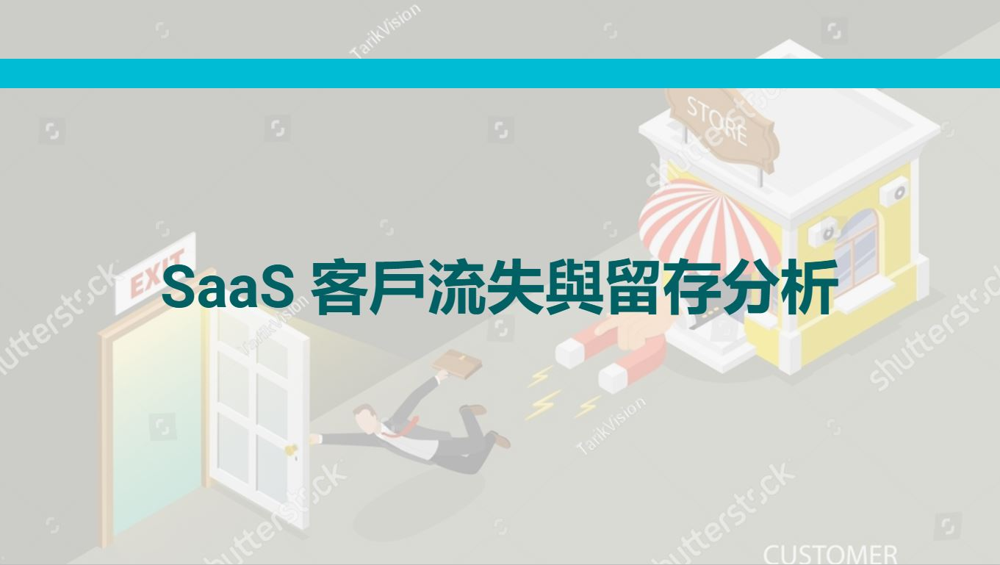
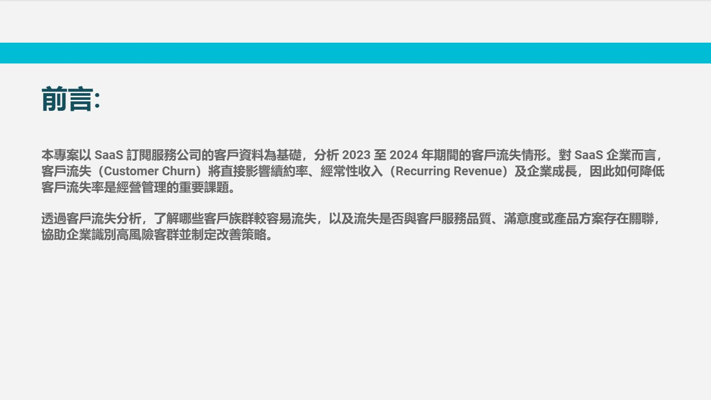
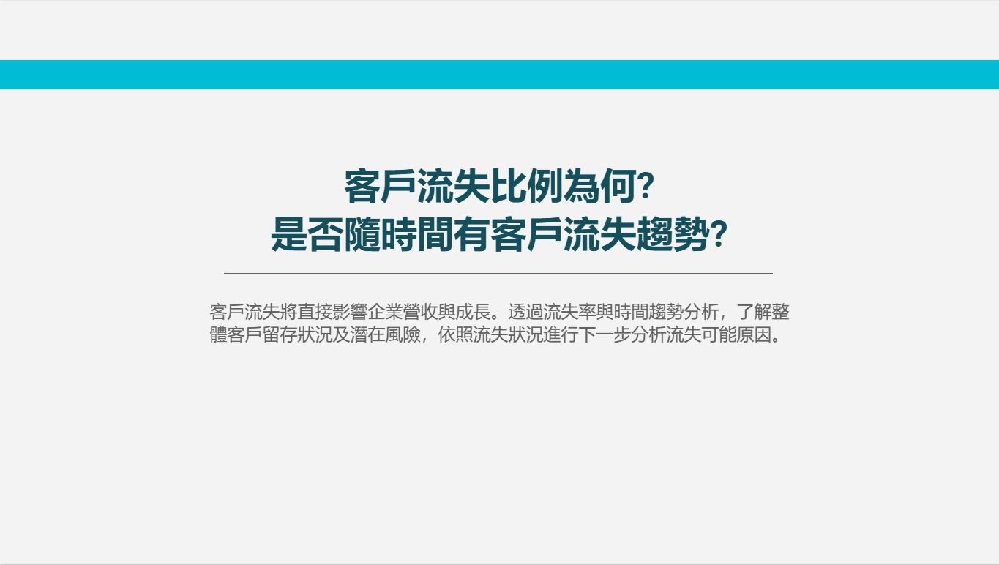
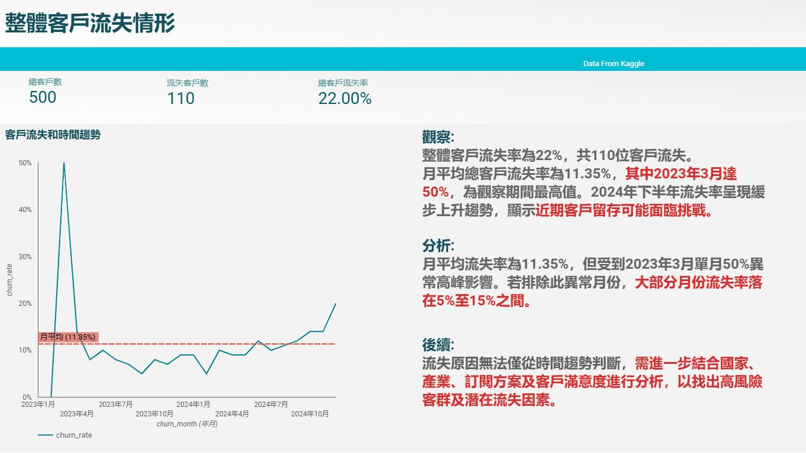

# SaaS Customer Churn & Retention Analysis

這是一份以 SaaS 訂閱資料為題的分析作品集：從「客戶何時離開、哪些族群值得關注」出發，示範如何把分散的營運資料整理成可閱讀的指標與調查方向。重點不在替流失找單一答案，而在建立一條能支持後續決策的分析路徑。

## 為什麼分析流失？

訂閱型服務仰賴續約與長期使用，客戶流失因此不只是單一事件，也可能影響收入穩定與成長。本專案以 2023–2024 年資料為範圍，先觀察流失的整體輪廓，再逐步檢視客戶屬性、方案、客服互動與產品使用等面向，尋找可以驗證的問題。

## 從總體趨勢開始

第一步先確認流失指標的規模與時間分布，辨認趨勢中的高低點；接著才追問這些變化是否集中在特定客群或服務經驗。這樣的順序能避免只看整體平均，而忽略需要進一步調查的局部訊號。

## 如何完成分析

- **整理資料**：盤點帳戶、訂閱、流失事件、功能使用及客服工單資料，確認欄位與關聯鍵。
- **建立指標**：以 SQL 和 BigQuery 計算整體、月度及分群流失指標，並以帳戶層級彙整產品功能使用，避免重複計數。
- **呈現洞察**：在 Looker Studio 將關鍵數字與趨勢放進同一閱讀脈絡，讓讀者由總覽進入後續的客群比較。

## 儀表板透露的線索

總覽顯示樣本中有 500 位客戶，其中 110 位在帳戶資料中標記為流失。月度走勢有明顯的單月尖峰，且觀察期尾端出現上揚；這些變化值得先檢查資料口徑及月份背景，再與客戶屬性、訂閱方案和客服經驗交叉分析。功能使用比較則以客戶為單位計數，協助找出流失客戶較常使用或較少使用的功能，作為產品團隊後續訪談與驗證的線索。

## 分析解讀與下一步

目前成果用來定位值得調查的客群與時間區段，不是因果結論，也不能單憑功能使用差異判定某項功能導致流失。下一步應先統一不同圖表的流失定義與觀察期間，再針對異常月份及分群差異回查資料，並以客戶回饋或實驗驗證可行的留存措施。

## 使用工具

`SQL` · `BigQuery` · `Looker Studio`
